# CS440 Online Fall 2026, MP 4: Shallow Learning and Gradient Descent
## Due: Sunday, October 18, 2026, 11:59 PM CT

## I. Overview

In this assignment you will explore some fundamental concepts in machine learning. You will fit functions to data by minimizing loss functions, and you will see three different ways to choose model parameters: analytically, by gradient descent, and by stochastic gradient descent. The same basic learning loop will allow you to do linear regression, polynomial regression, inverse kinematics for a planar robot arm, logistic regression for classification, and predicate classification with validation, preprocessing, and regularization.

**As always, you may not use an external code-assistance tool to write significant parts of your code. Since this assignment is mostly split between small functions, any inline code assistance is considered significant. When you get stuck, consult the NumPy documentation, ask questions on the forum, or come to office hours.**

## II. Getting Started

This assignment is structured more like a tutorial than the earlier MPs. To get full credit you need to pass all tests in `tests.py` (these are the same tests as the autograder), and we highly recommend working incrementally through the provided notebook `mp4.ipynb`. The notebook provides examples, plots, and suggested workflows, while this document gives the full mathematical specification for the functions you must implement (if you choose to work with the notebook you shouldn't have to refer to the instructions for any additional information).

Look inside the `template/` directory. It contains:

- `mp4.py`: most of your code for Parts 1-6 goes here
- `predicate_classifier.py`: your code for Part 7 goes here
- `tests.py`: local tests that match the autograder tests; you should not need to submit to Gradescope until you have finished the assignment - run this as `python tests.py` to check your work, or work through the notebook which runs these one at a time
- `mp4.ipynb`: a notebook that walks through the assignment
- `data/`: classification and predicate-classification datasets
- `planar_arm.py`: utilities for creating and drawing a planar robot arm (for inverse kinematics)
- `main.py`: optional plotting and visualization utilities

Notes:

- You can open the provided Python notebook in VS Code with the Jupyter extension or run it in a browser by [installing Jupyter](https://jupyter.org/install). If you have never worked with a Python notebook before, follow a short online tutorial or come to office hours for setup help.
- When using the notebook, remember that it imports from `mp4.py`; after changing `mp4.py`, you may need to rerun imports or restart the kernel
- Do not skip a function implementation, since later parts often call earlier functions
- One important goal is to practice vectorized linear algebra in NumPy

## III. Assignment

### 1. Setting Up Linear Regression

<figure align="center">
    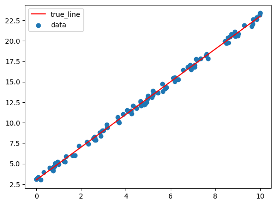
    <figcaption align = "center"><b>Synthetic linear data with true line</b></figcaption>
</figure>

You will start by creating data and implementing the basic pieces needed for linear regression.

Implement:

- `create_linear_data(num_samples, slope, intercept, x_range, noise)`
    - `create_linear_data` should return arrays `x` and `y`, each with shape `(num_samples, 1)`
    - Sample each `x_i` uniformly from the interval `[x_range[0], x_range[1]]`, and compute
    $$y_i = \text{slope} \cdot x_i + \text{intercept} + \epsilon_i$$
    - where each $\epsilon_i$ is sampled uniformly from $[-\text{noise}, \text{noise}]$
- `get_simple_linear_features(x)`
    - For linear regression, we will represent an affine function using a feature matrix with an added column of ones
    - If the original input matrix is $x \in \mathbb{R}^{N \times d}$ then `get_simple_linear_features(x)` should return
    $$ X = \begin{bmatrix} x & \mathbf{1} \end{bmatrix} \in \mathbb{R}^{N \times (d+1)}$$
- `linear_prediction(x, A, get_modified_features)`
    - Given parameters $A \in \mathbb{R}^{m \times 1}$ where $m$ is the number of modified features
    - `linear_prediction` should return $\hat{y} = X A$, 
    - where $X = $ `get_modified_features(x)`
- `mse_loss(y_pred, y_true)`
    - The mean squared error loss is
    $$\text{MSE}(\hat{y}, y) = \frac{1}{N}\sum_{i=1}^N (\hat{y}_i - y_i)^2$$
- `compute_model_error(x, y, A, get_modified_features)`
    - `compute_model_error` is just the MSE of the model's predictions on the provided data.

### 2. Analytical Linear Regression

<figure align="center">
    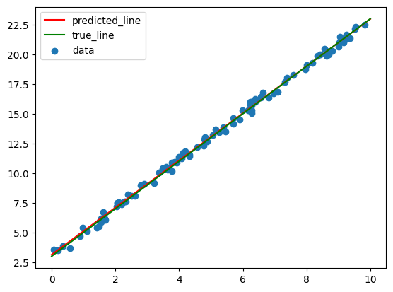
    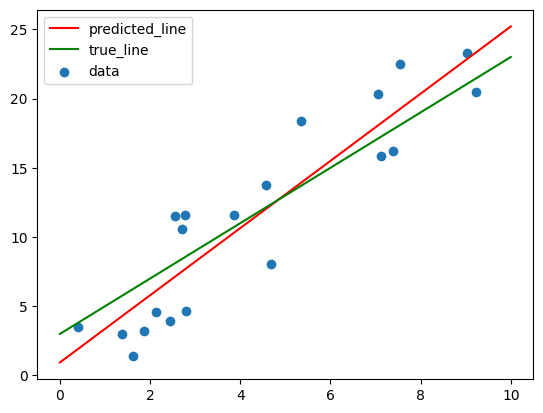
    <figcaption align = "center"><b>The more data we have with less noise the better our prediction is...</b></figcaption>
</figure>

Now you will compute the parameter matrix $A$ that minimizes mean squared error directly. Given modified features

$$
X \in \mathbb{R}^{N \times m}
$$

and labels

$$
y \in \mathbb{R}^{N \times 1},
$$

the least-squares solution is

$$
A = (X^T X)^{-1} X^T y.
$$

Implement `analytical_linear_regression(X, y)` using NumPy matrix operations. It should return an array with shape `(num_modified_features, 1)`.

### 3. Gradient Descent and Stochastic Gradient Descent

<figure align="center">
    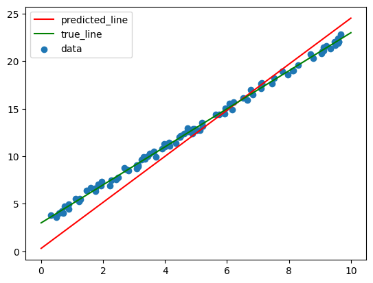
    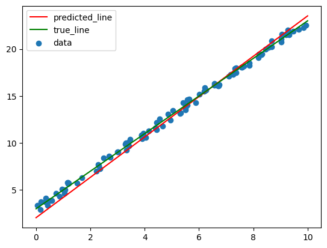
    <figcaption align = "center"><b>On the left we have 10 iterations of gradient descent and on the right we have 10 epochs of stochastic gradient descent with a batch size of 10. Both had a learning rate of 0.01. Even though both methods did 10 passes through the data, SGD does better because every full pass through the data does more updates to the parameters (even though those updates were individually less precise).</b></figcaption>
</figure>

For linear regression, the MSE loss can be written as

$$
L(A) = \frac{1}{N}\lVert y - XA \rVert_2^2.
$$

The gradient with respect to $A$ is

$$
\nabla_A L(A) = \frac{2}{N} X^T(XA - y).
$$

Implement `get_linear_regression_gradient(A, X, y)` to return this gradient with the same shape as `A`.

Next, implement `gradient_descent`. Starting from `A_init`, repeatedly update

$$
A \leftarrow A - \alpha \nabla_A L(A)
$$

where $\alpha$ is `learning_rate`. The function `get_gradient(A)` is provided as an argument so the same gradient descent code can be reused for different losses.

Then implement `stochastic_gradient_descent`. Instead of using the full dataset for every update, SGD uses batches of indices. For each epoch:

1. Create a random permutation of the dataset indices
2. Split those indices into batches of size `batch_size`
3. For each batch, compute the batch gradient using `get_batch_gradient(A, indices)`
4. Update `A` using the same gradient descent update rule

Make sure to shuffle before each epoch. `np.random.permutation` is useful here.

### 4. Fitting Sine Data With Polynomial Features

<figure align="center">
    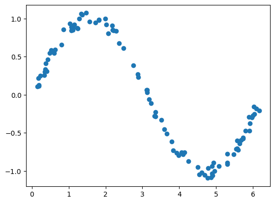
    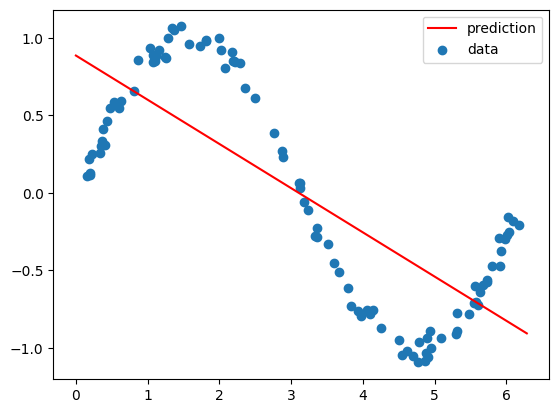
    <figcaption align = "center"><b>A linear function cannot fit this sinusoidal data...</b></figcaption>
</figure>
<figure align="center">
    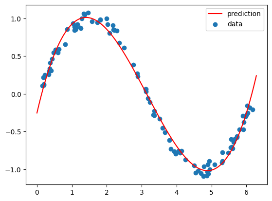
    <figcaption align = "center"><b>If we transform our features to polynomial we can now fit the data!</b></figcaption>
</figure>

In this part you will reuse linear regression, but with a different feature transform. We will transform the given features into polynomial features and then do linear regression on those transformed features. This is a common trick in machine learning and shows the value of preprocessing your data/features: we can fit more complex nonlinear functions of the original input by transforming the input features and then doing linear regression. Intuitively, this is similar to what a deep neural network does where the last layer computes some linear function of the final hidden layer activations which are nonlinear functions of the original input. Of course, in a neural network that initial nonlinear transformation is learned rather than hand-designed like polynomial features.

To see the value of these new features we first need some new data. Implement `create_sine_data` so that `x` and `y` each have shape `(num_samples, 1)`. Sample each $x_i$ uniformly from `[x_range[0], x_range[1]]`, and compute

$$
y_i = \sin(x_i) + \epsilon_i
$$

where each $\epsilon_i$ is sampled uniformly from $[-\text{noise}, \text{noise}]$.

Then implement `get_polynomial_features(x, degree)`. For an input matrix

$$
x \in \mathbb{R}^{N \times d},
$$

return the polynomial feature matrix

$$
X =
\begin{bmatrix}
x^{\text{degree}} & x^{\text{degree}-1} & \cdots & x & \mathbf{1}
\end{bmatrix}.
$$

The return shape should be

$$
(N,\ d(\text{degree}+1)).
$$

For this sine-fitting part, `num_features` (i.e., $d$) is usually $1$, but your implementation should handle multiple input features. Notice that the final two columns are exactly what we implemented in `get_simple_linear_features`! You can think of this new feature transform as a generalization of the simple linear features we used earlier.

### 5. Inverse Kinematics

<figure align="center">
    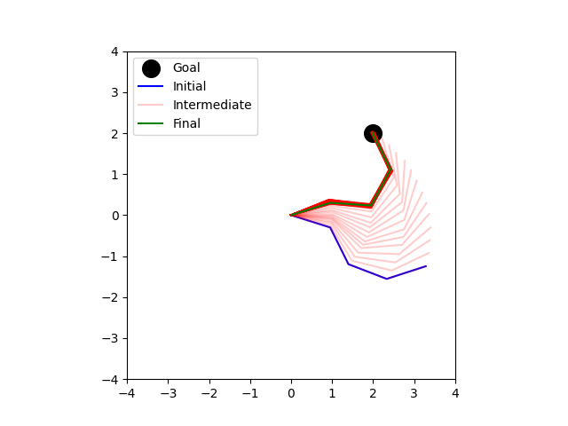
    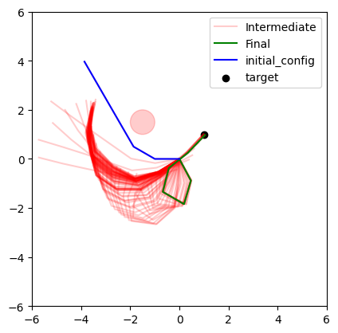
    <figcaption align = "center"><b>We can use gradient descent to move an arm so that its tip is in a desired position. By modifying our loss function we can even make it avoid obstacles (i.e., do motion planning).</b></figcaption>
</figure>

Now you will use gradient descent to update the configuration of a planar arm where a configuration is a vector/array of joint angles. The goal is to move the end effector, meaning the arm tip, close to a desired point in the workspace. This is inverse kinematics and *not* motion planning as we are not considering collisions with ourselves or obstacles, though later we will see how we can make our loss function incorporate obstacle avoidance (at which point we are essentially doing trajectory optimization). While we could attempt to analytically compute the gradient of the loss function with respect to the configuration (meaning how much closer does our end effector get to the goal as we change the joint angles), this is often geometrically difficult or even impossible for more complex robots. Instead, we will use a simple numerical approximation of the gradient based on finite differences (sampling).

Our main idea is to estimate a local gradient direction by sampling the loss function around the current configuration. One simple approach would be to estimate a local direction by looking for the single nearby sample with the largest loss and treating that as the uphill direction. While this matches the basic intuition that gradients point uphill, it is noisy and throws away most of the samples. A more stable idea is to let every sample vote on which way the gradient should point:

Suppose the current configuration is $q$, and we sample unit directions $u_i$. For each sampled direction, we can compute the nearby configuration as $$q_i = q + \epsilon u_i$$ for some small step size $\epsilon$, and therefore the loss at that nearby configuration as $L(q_i)$. Thus our "vote" for the gradient direction is $L(q_i) u_i$ - the higher the loss the more this direction should contribute to the overall gradient direction. We can average these votes to get a local estimate of the gradient direction:
$$ g = \frac{1}{N}\sum_i L(q_i) u_i $$

and thus the normalized gradient direction is
$$
\nabla L(q) = \frac{g}{\lVert g \rVert_2}.
$$

As we sample more this becomes a better estimate, but for a small number of samples it can lead to a biased estimate of the direction. To see why consider the following simple example: suppose we sample a direction $u_i$ and find that moving in that direction gives a loss of `100`, but what if the loss at the current configuration is also `100`? Then this direction is not an actual uphill direction! Again, with enough samples this will cancel out across samples in many different directions, but there are better ways to avoid this bias. One option is to subtract $L(q)$ from each vote, i.e., $$g = \frac{1}{N}\sum_i (L(q_i) - L(q)) u_i$$ and a second option is to sample both $u_i$ and $-u_i$ and compare the loss in both directions, i.e.,

$$
q_i^+ = q + \epsilon u_i, \quad q_i^- = q - \epsilon u_i,
$$
and thus
$$
g = \frac{1}{N}\sum_i \left( L(q_i^+) - L(q_i^-) \right)u_i.
$$

1. First implement the loss, `ik_loss(arm, config, goal)`, as the Euclidean distance between the end effector and the goal: $L(q) = \lVert \text{ee}(q) - g \rVert_2$
    - Here $q$ is the configuration, $g$ is the goal, and $\text{ee}(q)$ is the final point in workspace returned by `arm.forward_kinematics(config)`, i.e., `arm.forward_kinematics(config)[-1]`
    - We also provide `ik_loss_with_obstacles`, which adds a penalty for being close to circular obstacles. You do not need to modify this function but feel free to experiment with it
2. Now implement `sample_directions(num_samples, num_features)` by returning uniformly random unit directions
    - The result should have shape `(num_samples, num_features)`
    - Each row should have Euclidean norm 1
3. Finally implement `estimate_ik_gradient(loss, config, num_samples)` as follows:
    1. Sample random directions using `sample_directions`
    2. Move a small distance `epsilon` in those directions to get nearby configurations
    3. Evaluate the loss at the nearby configurations
    4. Estimate an average local direction of increasing loss (and debias either with the negative directions or by subtracting the current loss)
    5. Return that direction as a unit vector

Note that this inverse-kinematics method produces a sequence of configurations from the start to the final configuration. That sequence is not guaranteed to be a valid motion-planning path because it does not explicitly check every geometric constraint along the way. It is still a useful fast method for finding configurations whose end effector reaches a target.

### 6. Logistic Regression

<figure align="center">
    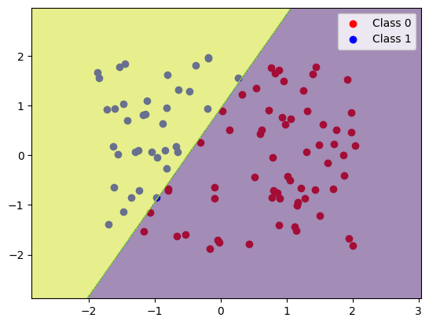
    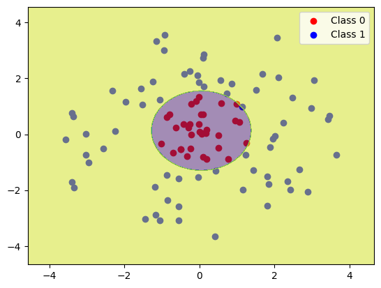
    <figcaption align = "center"><b>We can find a linear separator by doing logistic regression using our get_simple_linear_features. With polynomial features we can correctly classify the data on the right.</b></figcaption>
</figure>
<figure align="center">
    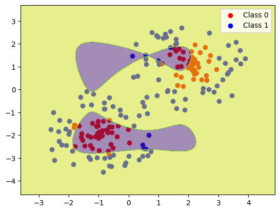
    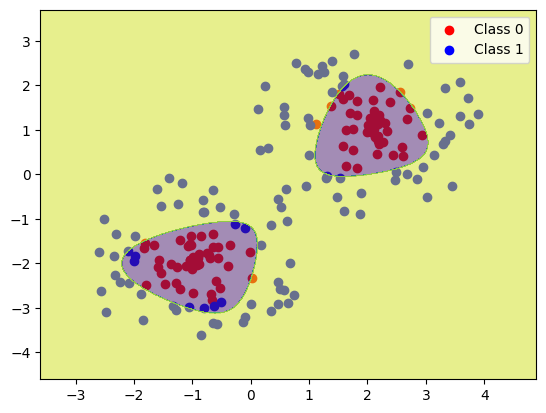
    <figcaption align = "center"><b>You will need to come up with your own features to correctly classify the third dataset above... On the left is what happens when we try degree 6 polynomial features. Can you come up with something that looks more like what we have on the right?</b></figcaption>
</figure>

Next, you will implement binary classification with logistic regression.

The logistic model first computes a linear score

$$
z = XA
$$

and then maps that score to a probability using the sigmoid function

$$
\sigma(z) = \frac{1}{1 + e^{-z}}.
$$

Implement `logistic_prediction(x, A, get_modified_features)` so that it returns

$$
\hat{y} = \sigma(XA)
$$

with shape `(num_samples, 1)`.

Implement `logistic_error(y_pred, y_true)` as the average classification error. A predicted probability greater than 0.5 should be classified as 1, and a predicted probability less than or equal to 0.5 should be classified as 0.

For binary labels $y_i \in \{0,1\}$, the logistic loss is

$$
L(\hat{y}, y)
= - \sum_i \left[
y_i \log(\hat{y}_i) +
(1-y_i)\log(1-\hat{y}_i)
\right].
$$

Implement `logistic_loss(y_pred, y_true)` using vectorized NumPy operations. Do not use a loop. Since $\log(0)$ is undefined, clip probabilities to a small interval such as $[\epsilon, 1-\epsilon]$ before taking logs.

The gradient of logistic loss with respect to $A$ is

$$
\nabla_A L(A) = X^T(\hat{y} - y).
$$

Implement `get_logistic_regression_gradient(A, X, y)`. Since `X` is already the modified feature matrix, you can call `logistic_prediction` with an identity feature transform, for example:

```python
lambda x: x
```

Finally, implement `get_logistic_regression_features(x)`. The first two datasets can be solved with simple linear or polynomial features, but the third dataset requires a feature transform you design yourself. Your returned feature matrix must have one row per data point, must be finite, and should allow gradient descent and stochastic gradient descent to reach at least 90% accuracy on each provided dataset.

### 7. Predicate Classification and Model Selection

In task planning, a symbolic state describes facts such as `block_a_is_clear` or `block_b_is_on_block_c`. Here you will infer 36 Boolean predicates from 784 noisy perception features. Each predicate has its own logistic-regression weight vector, so one matrix multiplication predicts all labels:

$$
X\in\mathbb{R}^{N\times(d+1)},\qquad W\in\mathbb{R}^{(d+1)\times P},\qquad \hat Y=\sigma(XW).
$$

Here $N$ is the number of samples, $d$ the number of input features, and $P$ the number of predicates. The final column of $X$ is a bias feature of ones. The provided `predicate_prediction` uses your Part 6 logistic prediction with an identity feature transform.

Implement the marked sections of **`compute_loss`, `compute_gradient`, `preprocess_data`, and `get_positive_weights`** in `predicate_classifier.py`. These functions are grouped at the end of the file. Data loading, training, evaluation, plotting, and model selection are provided. The data file is `data/task_planning_perception_features.npz`; the provided split helper reserves 270 examples for training, 90 for validation, and 400 for testing.

#### 7.1 Binary cross-entropy and its gradient

Implement the binary cross-entropy (BCE) calculation in `compute_loss` and its gradient in `compute_gradient`:

$$
L_{\mathrm{data}}=-\frac{1}{N}\sum_{i=1}^{N}\sum_{j=1}^{P}\left[y_{ij}\log\hat y_{ij}+(1-y_{ij})\log(1-\hat y_{ij})\right],
\qquad
\nabla_W L_{\mathrm{data}}=\frac{1}{N}X^T(\hat Y-Y).
$$

The template supplies predictions and clips probabilities before logarithms to avoid `log(0)`. Sum the losses over all labels and divide by the number of samples, not the number of labels. Store the scalar data loss in `bce`. The gradient must have shape `(num_features + 1, num_predicates)`, matching `weights`. Initially, use equal label weights and no regularization.

We evaluate predictions using **exact-match accuracy**: a sample is correct only if all 36 labels match after thresholding probabilities at `0.5`. BCE is a smooth training objective, but lowering BCE does not always increase exact-match accuracy. The provided trainer uses mini-batch SGD and selects the first checkpoint with the highest validation exact match.

<figure align="center">
    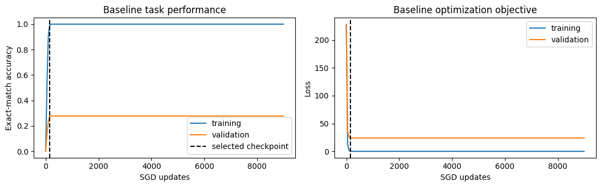
    <figcaption align="center"><b>The training loss and validation exact match measure different aspects of the model</b></figcaption>
</figure>

#### 7.2 Feature normalization

Features with large values can dominate gradient updates even when smaller features contain useful information. Complete `preprocess_data` to normalize each input feature when `normalize=True`:

$$
\mu_k=\operatorname{mean}(X_{:,k}),\qquad s_k=\operatorname{std}(X_{:,k}),\qquad X'_{ik}=\frac{X_{ik}-\mu_k}{s_k}.
$$

Compute means and standard deviations over samples, retaining shape `(1, num_features)`. Replace standard deviations below $10^{-8}$ with `1.0`. Store these training statistics in `PreprocessState`. When a state is supplied, reuse its statistics for validation or test data instead of recomputing them. Without normalization, leave features unchanged. The provided code appends the bias column, producing shape `(num_samples, num_features + 1)`. Do not modify the input array in place.

<figure align="center">
    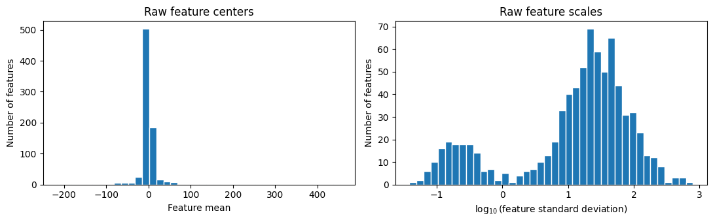
    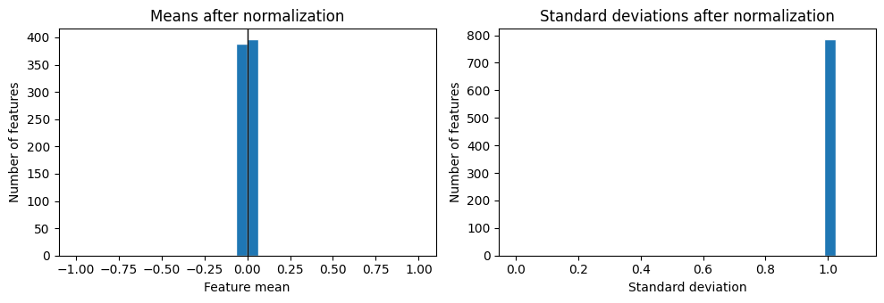
    <figcaption align="center"><b>Normalization centers the features and makes their scales comparable</b></figcaption>
</figure>

#### 7.3 L1 regularization

With more features than training examples, the model can fit noise. Extend `compute_loss` with an L1 penalty on the non-bias weights $W_{\mathrm{nb}}=W[:-1]$:

$$
L=L_{\mathrm{data}}+\lambda_1\lVert W_{\mathrm{nb}}\rVert_1.
$$

The strength is given by `l1_lambda`. Store the penalty in `penalty`, and add $\lambda_1\operatorname{sign}(W_{\mathrm{nb}})$ to `gradient[:-1]` in `compute_gradient`. These arrays have shape `(num_features, num_predicates)`. Do not penalize the bias row. Use a subgradient of zero at a zero weight, as returned by `np.sign`.

<figure align="center">
    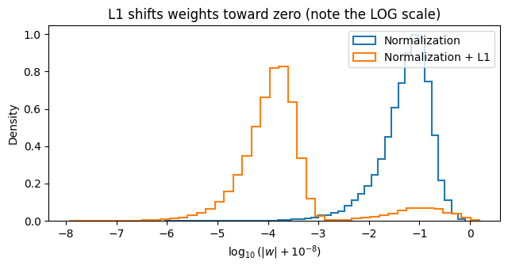
    <figcaption align="center"><b>L1 encourages small or zero coefficients, reducing the influence of nuisance features</b></figcaption>
</figure>

#### 7.4 Positive-label weighting

For rare predicates, ordinary BCE contains many more negative than positive examples. Complete `get_positive_weights` to compute one multiplier per predicate from its training-label counts:

$$
c_j=\operatorname{clip}\left(\left(\frac{n_j^-}{\max(n_j^+,1)}\right)^p,\ 0.5,\ 20\right).
$$

Here $n_j^+$ and $n_j^-$ are the positive and negative counts, and $p$ is `positive_weight_power`. Return an array with shape `(num_predicates,)`; the provided $p=0$ path returns ones.

Extend both `compute_loss` and `compute_gradient` to apply these multipliers to positive labels only. Let $a_{ij}=c_j$ if $y_{ij}=1$ and $a_{ij}=1$ otherwise. Multiply each BCE term by $a_{ij}$ and use the weighted data gradient

$$
\nabla_W L_{\mathrm{data}}=\frac{1}{N}X^T\left(A\odot(\hat Y-Y)\right).
$$

$A$, $Y$, and $\hat Y$ each have shape `(num_samples, num_predicates)`, and $\odot$ is elementwise multiplication. If `positive_weights` is `None`, use equal weights. Keep the L1 penalty and its gradient unchanged.

<figure align="center">
    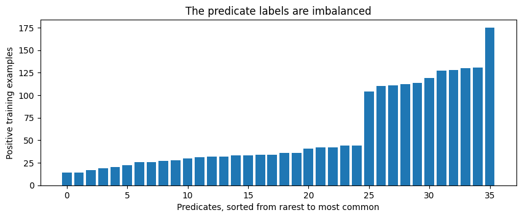
    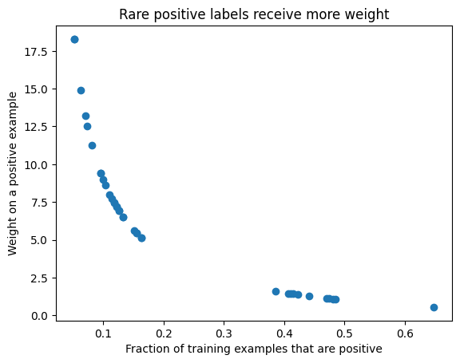
    <figcaption align="center"><b>Weighting increases the contribution of rare positive labels</b></figcaption>
</figure>

#### 7.5 Model selection with the provided helpers

`validation_experiment` is provided and requires no implementation on your part. It tries all eight configurations in `ABLATION_CONFIGS`: normalization on or off, `l1_lambda` in `{0, 0.001}`, and `positive_weight_power` in `{0, 1}`. These are hyperparameters chosen using validation data; the model weights and preprocessing statistics are learned from training data.

For each configuration, the helper trains a model, transforms validation inputs using that model's training statistics, and measures validation exact match. Every run uses the same seed, learning rate, batch size, and update budget. The helper returns `(best_config, results)`, selecting the first configuration with the highest validation score. Each result row contains the three configuration values, `val_exact_match`, and `selected_update`.

This is a deliberately small search to demonstrate model selection. Normally we would try many more values for regularization strength and positive-label weighting, and also consider different learning rates and batch sizes. Test data must not influence these choices.

The following results use seed 7. Comparing all subsets shows which components help alone and which help in combination:

| Components                              | Validation exact match |
| :-------------------------------------- | ---------------------: |
| Baseline                                |                  27.8% |
| Normalization                           |                  58.9% |
| L1                                      |                  30.0% |
| Positive weighting                      |                  26.7% |
| Normalization + L1                      |                  97.8% |
| Normalization + Positive weighting      |                  44.4% |
| L1 + Positive weighting                 |                  26.7% |
| Normalization + L1 + Positive weighting |                  98.9% |

<figure align="center">
    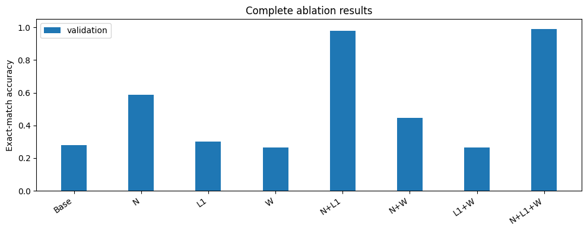
    <figcaption align="center"><b>Validation results for every subset (N: normalization, W: positive weighting)</b></figcaption>
</figure>

The provided final demonstration recreates the selected model with the same seed and evaluates it on the test split once. Training and validation remain separate because `train_model` uses validation to select a checkpoint. The staff solution selects normalization + L1 + positive weighting, achieving **98.9% validation exact match** and **98.2% test exact match**.

<figure align="center">
    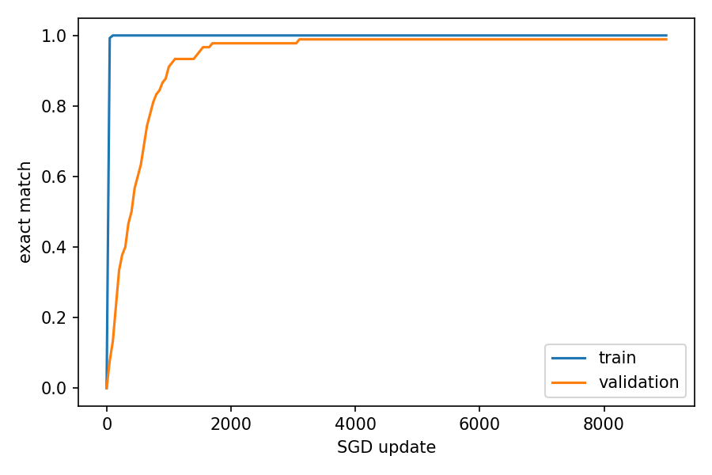
    <figcaption align="center"><b>Training and validation performance for the selected configuration</b></figcaption>
</figure>

Run `tests.py` to check the five Part 7 tests. The loss and gradient tests also accept `"baseline"`, `"regularized"`, or `"weighted"` to check an individual stage while implementing the functions.

## Submission Instructions

Submit this assignment by uploading `mp4.py` and `predicate_classifier.py` to
Gradescope. Do not submit `tests.py`, `main.py`, `planar_arm.py`, or the data
files. Before submitting, comment out or remove debugging print statements,
since excessive printing can slow down the autograder. Notice that for this assignment you can just run all the tests in `tests.py` to check your work before submitting. 

Do not forget to access Gradescope from the Launch App button in Coursera so that your grade is automatically synced.

## Policies

You are expected to be familiar with the general policies on the course syllabus, including academic integrity. In particular, this is an individual assignment, and you may not use external sources to write significant parts of your code for you.
